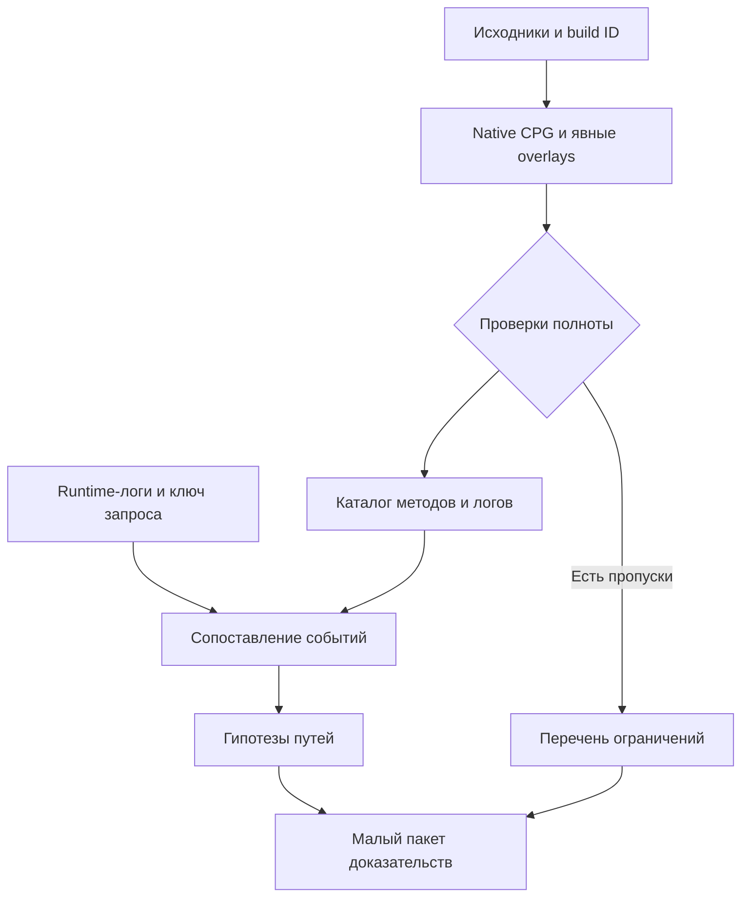

# Архитектура инструмента RCA после экспериментов

Дата: 22 ноября 2026 года. Это проект следующего этапа. Измеренные результаты
находятся в [отчёте Actions](2026-11-22-actions.md). Предложенный ниже API и новый
формат каталога ещё не реализованы.

## 1. Решение на основе полученных данных

Сохранить Joern как текущий источник графа. Убрать лишние обходы в Python.
Проверять полноту Java frontend отдельно от скорости. Следующим экспериментом
сравнить native export малого каталога с полным DOT и NetworkX. Решение о смене
frontend принять после проверки одинакового набора конструкций и методов.

Основания для такого порядка:

- Локальный обход рёбер уже ускорил FLOW/FSM в 29,2 раза на одном фиксированном
  графе snapshots. Его 180 выходных файлов совпали во всех шести запусках.
- Удаление 41,7% рёбер дало только 10,1% снижения RSS. Все узлы и Python-объекты
  остались. Это ограничивает пользу дальнейшего удаления меток.
- Исправление версии JavaParser не вернуло операции `yield`. Lambda в enum
  продолжает терять тело. Для этих случаев нужен исправленный перевод AST.
- Bytecode frontend сохранил две проверенные операции. Стоимость сборки
  OpenSearch и правильность всех CFG-переходов пока не измерены.
- Большой native CPG OpenSearch со штатными исключениями прошёл все пять
  overlays. Получены 5,59 млн узлов и 40,37 млн рёбер при пике RSS 9,68 GiB.
  [Результат](../../eval/results/actions-2026-11-22/opensearch-full-overlays.json)
  подтверждает применимость native пути в этом лимите. Полный DOT/NetworkX
  pipeline на таком графе ещё не измерен.

Это выводы из наших измерений, а не общий рейтинг инструментов. Источники:
[method comparison](../../eval/results/actions-2026-11-22/method-comparison.json),
[edge projection](../../eval/results/actions-2026-11-22/edge-projection.json),
[source frontend](../../eval/results/actions-2026-11-22/java-source-comparison.json),
[bytecode probe](../../eval/results/actions-2026-11-22/java-bytecode-summary.json).

## 2. Разделить четыре задачи

Сейчас результат одного этапа может выглядеть убедительно, даже если предыдущий
этап потерял данные. Поэтому каждый этап должен иметь свой результат проверки.

| Задача | Что нужно установить | Что не является достаточной проверкой |
|---|---|---|
| Разбор исходников | Известные методы и конструкции представлены правильно | Exit code 0 или рост числа узлов |
| Извлечение логов и путей | Шаблоны, CALL ID, ветки и возвраты сохранены | Только итоговый процент покрытия |
| Привязка runtime | Событие связано с допустимыми местами кода и запросом | Совпадение текста или одной секунды времени |
| Диагноз | Доказательства различают причины инцидента | Наличие пути в статическом графе |

Raw native CPG не следует называть готовым графом для RCA. В проверенном
notifier после Java parse нет рёбер CFG, CALL и REACHING_DEF. Эти связи возникают
на следующих этапах. Их время, память и полнота должны входить в бюджет.
Источник: [native notifier smoke](https://github.com/moleus/cpg_rca/blob/experiment/opensearch-large-scale/eval/results/native-count-query/notifier-smoke.json).

## 3. Предлагаемый поток данных



Стрелка из проверки полноты в каталог не означает обязательный запрет при любом
пропуске. Неполный анализ может быть полезен. Но пакет доказательств должен
показывать этот пропуск. Политика потребителя решает, достаточно ли данных.

### Native CPG остаётся частью offline-подготовки

Подготовка должна иметь отдельные этапы: разбор, добавление нужных overlays,
извлечение каталога, построение FLOW/FSM. Для каждого этапа сохраняются время,
CPU, sampled RSS, размер результата и причина остановки. Нельзя объединять
стоимость JVM startup и собственно прохода, если цель — сравнить два прохода.

Следующий формат должен содержать только данные, которые нужны построителю:
идентификатор метода, исходное место, локальные узлы и переходы, шаблоны логов,
места вызова и явно обозначенные неполные связи. Для методов нужен общий
каталог. Повторное использование callee не должно копировать всё его тело
для каждого entrypoint.

Для первой проверки подходит JSONL с одной записью на метод и отдельным
индексом мест вызова. SQLite можно оценить как вариант выборочного чтения.
Это кандидаты для измерения, не обещание ускорения. Требуется сравнить размер,
время загрузки, RSS, время выборки и точное равенство выходов с текущим путём.

Ключ кеша должен включать SHA исходников, frontend и его настройки, состав
overlays, версию extractor и схему каталога. При изменении callee следует
пересчитать зависимые summaries. Один хеш файла без учёта зависимостей для
такого кеша недостаточен.

### FSM должна учитывать место вызова

В snapshots FSM теряет 23 из 69 уникальных достижимых точек логирования.
При учёте каждой пары `(entrypoint, log CALL)` теряются 77 из 123 пар.
Все 77 относятся к вызываемым методам. Сейчас FSM строится по
графу входного метода. Источник:
[coverage в итоговом pipeline](../../eval/results/research-2026-11-22/opensearch-final-pipeline.json).

Простое объединение графов методов может создать ложный возврат в другой
call site. Нужны связанная пара «вызов — продолжение» и ограничение глубины.
Для начала достаточно проверить синхронные вызовы. Рекурсия, исключения,
callback и async должны иметь отдельные правила. Достижение предела анализа
означает неполный статический путь, а не успешное завершение цепочки.

### Online-состояние должно иметь явные пределы

Общий неизменяемый префикс истории уменьшает копирование. Но он не задаёт предел
длительности работы. Отдельный opt-in индекс active/completed уже прошёл
[Actions](https://github.com/moleus/cpg_rca/actions/runs/45025027002): на 20 000
синтетических событиях медиана store снизилась с 30,983 до 0,547 секунды.
Его договор сохраняет прямые изменения через публичные views с возвратом к scan.
Следующие задачи — review индекса на нескольких потоках, политика TTL и передача
завершённого результата потребителю. Удаление архивной гипотезы не должно
разрушать префикс живой ветки.

Лимиты следует задавать отдельно: активные гипотезы на ключ, общий объём
истории, время без продолжения и размер экспортируемого ответа. Каждое
срабатывание лимита должно оставлять машинную причину. Проверка должна
включать несколько чередующихся запросов и долгий поток после заполнения окна.

## 4. Что должен получать агент

Агенту нужен проверяемый ответ на узкий вопрос: какие места кода и допустимые
пути согласуются с этими событиями. Полный CPG обычно не нужен в его контексте.
Инструмент должен вернуть кандидатов, ограничения и ссылки на доказательства.

Минимальный проект API:

| Операция | Вход | Выход |
|---|---|---|
| `inspect_artifact` | Идентификатор графа | Версии, scope, overlays, ошибки и пропуски |
| `match_logs` | События, service, build ID | Matched, unmatched, неоднозначные CALL ID |
| `explain_path` | Ключ запроса, CALL ID, предел пути | Допустимые переходы и причины неполноты |
| `source_context` | Идентификаторы кандидатов, бюджет | Только нужные участки кода и их версии |

Пример полей ответа, а не уже работающий endpoint:

```json
{
  "schema_version": 1,
  "source_commit": "<pinned-commit>",
  "service": "<service-id>",
  "correlation": {"kind": "explicit_field", "field": "request_id"},
  "matches": [],
  "unmatched_events": [],
  "candidate_paths": [],
  "limitations": ["incomplete_callee_model"],
  "causal_diagnosis": "not_established"
}
```

Кандидат должен иметь источник: event ID, CALL ID, файл, строку, шаблон и
основание перехода. Статическое boolean-условие не следует представлять как
наблюдённое значение. Общий trace ID помогает связать события, но сам по себе
не доказывает причинный порядок между сервисами. Отсутствующий ключ запроса
нельзя незаметно заменить временным bucket.

Ответ нужно ограничивать числом кандидатов и объёмом кода. При усечении следует
вернуть число пропущенных элементов и способ запросить следующую часть. Это
позволит отдельно измерить пользу графа и стоимость контекста агента.

## 5. Какие инструменты сравнивать

Следующая таблица использует официальную документацию, проверенную 22 ноября
2026 года. Скорость и полнота альтернатив на OpenSearch нами не измерены.

| Кандидат | Возможная роль | Что нужно проверить до замены |
|---|---|---|
| Joern Java source + native export | Сохранить текущую модель CPG и extractor | Потери `yield`, enum lambda, полный бюджет overlays, компактный экспорт |
| Joern `jimple2cpg` | Получить операции из bytecode при доступной сборке | Сборку модуля, classpath, исходные строки и CFG; два fixture уже проверены |
| SootUp | Java/JVM-анализ через Jimple, call graph и межпроцедурные анализы | Адаптер каталога логов, современный bytecode, стоимость build и корректность связей |
| Spoon | Source AST, позиции и точное извлечение выражений Java | Поддержку конструкций, разрешение ссылок и дополнительные анализы для путей |
| CodeQL | Проверочный backend для Java call graph и data flow | Извлечение базы, запросы нашего scope, стоимость и способ распространения результата |
| Tree-sitter | Быстрый синтаксический индекс и поиск мест логирования | Грамматику Java и ложные кандидаты; синтаксическое дерево не заменяет модель вызовов |

SootUp документирует Jimple, call graph и IFDS/IDE. Это делает его подходящим
кандидатом для Java-части, но не делает его совместимым с нашим CPG автоматически.
Источник: [SootUp, What is SootUp](https://soot-oss.github.io/SootUp/latest/).

Spoon строит AST исходного Java-кода и предоставляет API анализа и
преобразования. Поэтому его полезно проверить как независимый источник
структуры выражений. Источник: [официальная документация Spoon](https://spoon.gforge.inria.fr/).

CodeQL предоставляет локальный и глобальный data flow для Java/Kotlin. Для
нашей задачи нужно отдельно написать запросы и проверить полученные места
кода. Источник: [CodeQL Java data flow](https://codeql.github.com/docs/codeql-language-guides/analyzing-data-flow-in-java/).

Tree-sitter строит concrete syntax tree и поддерживает его обновление при
изменении файла. Предлагаемая роль синтаксического индекса — наш вывод из этого
API. Источник: [официальный README Tree-sitter](https://github.com/tree-sitter/tree-sitter).

Нельзя сравнивать время Tree-sitter parse с полным Joern CPG и объявлять первый
путь быстрее для RCA. Эти этапы вычисляют разные данные. Сравнение должно
иметь одинаковый результат: известные log calls, правильные выражения,
владельцы методов, CFG и необходимые межпроцедурные связи.

## 6. Как проверить пользу для агента

Первый pilot содержит один независимый инцидент. Оба агента выбрали тот же
правильный сервис. Добавление статических кандидатов увеличило вход с 9290
до 25 263 байт. Это не доказывает рост точности. Источник:
[pilot summary](../../eval/results/agent-pilot/summary.json).

Следующая оценка должна разделять выбор сервиса и механизм сбоя. Для каждого
инцидента нужны исходный commit, конфигурация, логи, подтверждённая причина
и проверяемые доказательства. Метки причины следует хранить отдельно от
пакета агента. Имя файла не должно раскрывать ответ.

Сравнивать следует три условия: только логи; логи и статические кандидаты;
логи и инструмент с ограниченными запросами. Для каждого условия нужны новые
агенты, одинаковая модель, одинаковый бюджет и перемешанный порядок. Ответ
оценивается по общей схеме. Незавершённые запуски остаются в знаменателе.

| Уровень | Метрика |
|---|---|
| Статический разбор | Доля известных конструкций и методов с правильной семантикой |
| Matching | Recall размеченных событий и доля ложных/неоднозначных кандидатов |
| Путь | Правильность call site, возврата и связи с конкретным запросом |
| Диагноз | Top-1/Top-k сервиса отдельно от правильности механизма сбоя |
| Доказательства | Доля верных ссылок и неподтверждённых причинных утверждений |
| Ресурсы | Время, токены, обращения к инструменту, размер контекста и RSS |

Повторные прогоны одного инцидента измеряют разброс ответа. Они не увеличивают
число независимых инцидентов. Доверительные интервалы следует считать по
инцидентам, сохраняя парное сравнение условий. При малом наборе нужно показать
результаты каждого случая и не делать общий вывод о превосходстве.

## 7. Порядок следующей работы

1. Провести review узких исправлений. Локальный обход рёбер уже имеет точное
   сравнение выходов и измерение. Согласовать загрузку графа с исполнителем #10.
2. Вынести два воспроизводимых сбоя Java frontend в отдельные upstream-отчёты.
   Подготовленные данные позволяют различить ошибку синтаксиса и перевод AST.
3. Использовать проверенную явную последовательность overlays. Измерить
   компактный каталог на том же входе и сохранить равенство результата.
4. Добавить call/return в FSM с ограниченным scope. Проверить два call site
   одного метода до перехода к рекурсии и async.
5. Ограничить online-состояние и проверить долгий поток. Индекс активных
   гипотез и политика удаления истории — разные изменения.
6. Собрать несколько независимых инцидентов с совпадающей версией исходников.
   Только после этого оценивать пользу инструмента для диагноза.

Критерии приёмки для этих работ находятся в [проекте issues](2026-11-22-next-issues.md).
